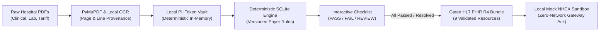

# ClaimKavach — Intelligent Healthcare Claim Verification & Policy Guardrail

<div align="center">
  
  <h3>Zero-Dispute Pre-Submission Intelligence for Hospital Billing Desks</h3>
  <p><strong>Local-First Document Extraction · Deterministic SQLite Policy Rules · In-Memory PII Token Vault · Gated HL7 FHIR R4 (4.0.1) Bundles</strong></p>
</div>

---

> **MANDATORY BOUNDARY & REGULATORY DISCLOSURE**
> - **`FHIR R4 STRUCTURE CHECKED — NHCX/HCX PROFILE VALIDATION NOT IMPLEMENTED.`**
> - FHIR R4 structural validation ensures JSON resource schema validity (4.0.1); full NHCX/HCX profile conformance, live insurance gateway submission, and claim adjudication are out of scope.
> - **Local-First Privacy Boundary:** All patient records are processed locally in-memory. Personal identifiers are replaced with deterministic per-claim tokens (`[PATIENT_NAME_1]`) into a local token vault before any external reasoning. Raw PDFs and unmasked PII never leave the local machine.

---

## The Problem ClaimKavach Solves

Every day, hospital billing desks submit insurance claims under intense patient discharge pressure. Avoidable clerical discrepancies and missing diagnostic documentation lead to severe operational gridlock:

- **34% Avoidable Pre-Submission Defects:** Claims fail simply because an itemized tariff breakdown was omitted, a lab slip said *"Report Awaited"*, or admission dates conflicted between charts.
- **14 Days Average Query Cycle:** When an insurer flags an issue post-submission, billing clerks spend days retrieving physical charts, re-scanning documents, and answering TPA queries while patients remain stranded.
- **₹4,200 Cr Working Capital Frozen:** Hospitals shoulder immense liquidity strain waiting for dispute resolution.

**ClaimKavach shifts verification directly to the hospital desk before gateway transit.**

---

## Architecture & Verification Pipeline



1. **Local Document Ingestion (`document_processor.py`):**
   - Enforces `%PDF` magic-byte verification and 20 MB size limit.
   - Extracts digital text via PyMuPDF (`fitz`) with exact page number and line coordinates (`p.1 L.14`).
   - Tesseract OCR fallback for scanned raster records.
2. **Deterministic In-Memory PII Token Vault (`pii_masker.py`):**
   - Masks patient names, UHIDs, phone numbers, and policy IDs into per-claim tokens (`[PATIENT_NAME_1]`).
   - Raw patient documents and direct identifiers never touch external networks or cloud LLMs.
3. **Deterministic SQLite Rules Engine (`rules_engine.py`):**
   - Evaluates active, approved payer policies (e.g. Policy A1, A2, B1, B2).
   - Enforces sub-limit caps, 24-hour diagnostic windows, non-payable consumables, and cross-document date consistency.
4. **Human Reviewer Rationale & Audit Logging:**
   - Any `REVIEW` findings (e.g., date discrepancies or manual clinical reviews) can be resolved by authorized reviewers (`billing_reviewer_01`) recording signed rationales.
   - Preserves original findings in immutable audit logs.
5. **Gated HL7 FHIR R4 Export & Mock NHCX Gateway (`fhir_builder.py`):**
   - Strict backend gate locks export until all evidence is verified (100% readiness).
   - Generates genuine HL7 FHIR R4 (4.0.1) `Bundle` containing `Patient`, `Coverage`, `Encounter`, `Condition`, `Claim`, and `DocumentReference` resources.
   - Includes local Mock NHCX Gateway simulation with auto-check and error simulation modes.
6. **Explainable Assessment Reports (`report_generator.py`):**
   - Generates a local branded PDF containing claim context, evidence inventory, deterministic findings, readiness scoring, gate status, and next actions.
   - Reports distinguish verification assessment from final payment adjudication and identify synthetic demonstration data.

### Operational Intelligence Phases

The Intelligence Center exposes the requested phased workflow from the same local evidence record:

1. **Classification and scan quality:** every document receives a deterministic type, processing mode, and ingest-quality score. The score describes extraction quality only; it is not clinical validation.
2. **Evidence provenance:** extracted fields retain document, page, excerpt, and confidence metadata for reviewer inspection.
3. **Missing-document recommendations:** missing types are derived from applicable approved rules and presented with an upload recommendation.
4. **Denial-risk and SLA prioritization:** persisted FAIL/REVIEW findings, missing evidence, and scan quality produce an operational priority. The timer is explicitly based on the last persisted update and is not a legal or insurer SLA determination.
5. **Integrity signals and policy copilot:** duplicate/cross-document conflicts are surfaced as review signals, while the local policy copilot answers only from cited approved synthetic rules. Neither produces a fraud finding, coverage decision, or payment adjudication.

## Hospital REST API

The local Express server exposes a versioned B2B API backed by the same Python rule engine:

- `POST /api/v1/keys/generate` creates a sandbox (`ck_test_`) or production (`ck_live_`) key. The raw secret is returned once; SQLite stores only its SHA-256 hash.
- `GET /api/v1/keys` lists masked prefixes and usage metadata.
- `POST /api/v1/keys/:id/revoke` immediately revokes a key.
- `POST /api/v1/audit-claim` accepts JSON base64 PDFs or multipart `documents` uploads. It requires `Authorization: Bearer <key>` or `X-API-Key: <key>`.
- `GET /api/v1/developer` returns integration metadata; the in-app **Developer Portal** provides key management and request examples.

`audit-claim` maps `INS-DEMO-01` to Fictional Insurer A and `INS-DEMO-02` to Fictional Insurer B, evaluates the configured policy code through the deterministic rules engine, and returns `status: "PASS"` with a FHIR R4 `collection` bundle only when the backend gate is clear. Blocked audits return remediation findings and `fhir_r4_bundle: null`. The API’s masking response explicitly avoids claiming DPDP compliance certification; the existing local masking limitation notice remains authoritative.

---

## Design System & UX Philosophy

- **Typography:** Modern, clean geometric typography powered by **Poppins** (weights 300 through 900) and **JetBrains Mono** for data provenance coordinates and JSON inspect.
- **Brand Palette:**
  - Deep Command Navy (`#07111F`) — Operational Surface
  - Cyan Signal (`#22D3EE`) — Primary Action Accent
  - Deep Navy (`#042D4F`) — Brand Shield Base
  - Neutral Off-Black (`#0A0A0A`) — High-Contrast Typography
  - Success Green (`#16834A`) — Validated Conformance
  - Amber (`#E6A000`) — Human Review Gate
  - Crimson (`#D93636`) — Critical Evidence Failure
- **Vector Brand Logo:** Dark Navy Shield with Centered White Heart (`<ClaimKavachLogo />`).

---

## Repository Structure

```
claimkavach-mvp-v2/
├── src/
│   ├── components/
│   │   ├── common/
│   │   │   └── ClaimKavachLogo.tsx      # Vector Shield + Heart Logo
│   │   └── layout/
│   │       ├── Navbar.tsx               # Top Universal Brand Nav
│   │       ├── Sidebar.tsx              # Workspace Console Sidebar
│   │       └── Footer.tsx               # Editorial Regulatory Footer
│   ├── pages/
│   │   ├── LandingPage.tsx              # Editorial Public Landing Page
│   │   ├── LoginPage.tsx                # Enterprise Hospital Station Login
│   │   ├── DashboardPage.tsx            # Administrator Console Overview
│   │   ├── NewClaimPage.tsx             # Guided PDF-First Ingestion Workflow
│   │   ├── VerificationProgressPage.tsx # 6-Stage Animated Execution
│   │   ├── VerificationResultsPage.tsx  # 23-Rule Checklist & FHIR Viewer
│   │   ├── AllClaimsPage.tsx            # Claims Registry Table
│   │   ├── PoliciesPage.tsx             # Insurer & Policy Catalog
│   │   ├── RulesPage.tsx                # SQLite Versioned Rules Engine
│   │   ├── DocumentsPage.tsx            # Asset Archive with Line Provenance
│   │   ├── ReportsPage.tsx              # Audit Analytics & JSON Export
│   │   └── SettingsPage.tsx             # Architecture & PII Vault
│   ├── services/
│   │   └── api.ts                       # Backend Bridge Communication
│   ├── types/
│   │   └── claim.ts                     # TypeScript Domain Models
│   ├── App.tsx                          # Central App Orchestrator & Router
│   ├── index.css                        # Tailwind CSS v4 & Poppins Variables
│   └── main.tsx                         # React 18 Entry Point
├── sample_data/                         # Standard Clinical Test Case Packets
├── server.ts                            # Node/TSX API Bridge & Vite Dev Server
├── cli_bridge.py                        # Python Headless CLI Bridge
├── database.py                          # SQLite Rule & Policy Engine
├── document_processor.py                # PyMuPDF Local PDF Extractor
├── pii_masker.py                        # In-Memory Token Vault
├── rules_engine.py                      # Rule Evaluator
├── fhir_builder.py                      # HL7 FHIR R4 (4.0.1) Generator
└── package.json
```

---

## Quickstart & Installation

### Prerequisites
- Node.js 18+
- Python 3.10+ (with `fitz` / PyMuPDF, `fhir.resources`, `pydantic`)

### Setup & Run

1. **Install Frontend Dependencies:**
   ```bash
   npm install
   ```

2. **Install Python Requirements:**
   ```bash
   pip install -r requirements.txt
   ```

3. **Start the Development Platform:**
   ```bash
   npm run dev
   ```
   Open `http://localhost:3000` in your browser.

4. **Verify TypeScript & Build:**
   ```bash
   npx tsc --noEmit
   npm run build
   ```

---

## Presentation Walkthrough for Hackathon Jury

1. **Landing Page Overview:** Present the **Shield + Heart vector logo** and the value proposition: pre-verifying claims before insurer transit.
2. **1-Click Benchmark Inpatient Case:** Click **"RUN BENCHMARK AUDIT (100% PASS)"** directly from the landing page.
3. **Live AI Extraction Pipeline:** Show the 6-stage animated processing sequence parsing raw hospital PDFs without manual typing.
4. **23 Passed Rules:** Inspect the 23-rule checklist verifying NS1 antigen reactivity, platelet counts, room rent tariff caps, and cross-document admission dates.
5. **Human Review Resolution:** Demonstrate how `REVIEW` items can be signed off with clinical rationales (`billing_reviewer_01`) to unblock the gate.
6. **FHIR R4 Bundle & NHCX Sandbox:** Inspect and download the valid HL7 FHIR R4 (4.0.1) draft bundle and test local NHCX simulation.
